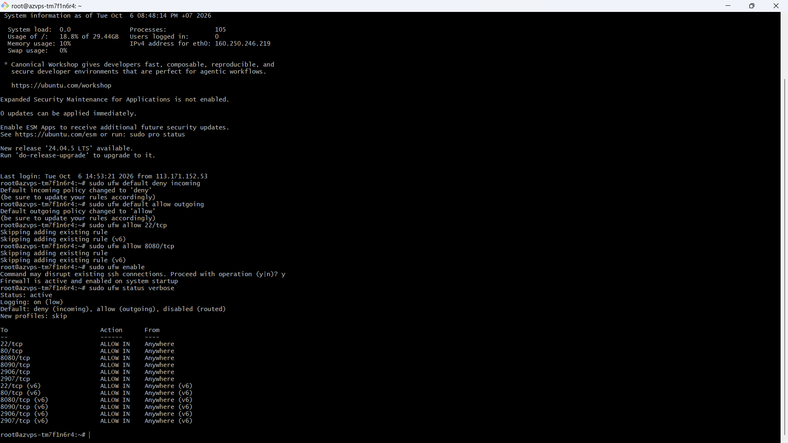

# Báo Cáo Bài Tập 3 (Session 06): Cấu Hình Tường Lửa UFW Và Chẩn Đoán Cổng Mạng

- **Khóa học:** IT209 - DevOps
- **Họ và tên:** Nguyễn Tiến Thành
- **Mã số sinh viên (MSSV):** B24DTCN283
- **Email:** thenngk6@gmail.com
- **GitHub Username:** ThanhDZsudo
- **Đường dẫn nộp bài dự kiến:** `homework/session_06/ex3/`

---

## 1. Mục Tiêu Bài Tập
- Làm chủ công cụ tường lửa **UFW (Uncomplicated Firewall)** để thiết lập lá chắn bảo vệ máy chủ Cloud VPS.
- Áp dụng nguyên tắc đặc quyền tối thiểu (**Principle of Least Privilege**): Chặn toàn bộ lưu lượng không xác định đi vào, chỉ mở duy nhất các cổng thực sự cần thiết phục vụ vận hành và triển khai ứng dụng.
- Sử dụng các công cụ chẩn đoán mạng chuyên sâu (`ufw status verbose`, `ss -tlnp`, `curl`) để kiểm tra, giám sát trạng thái mở cổng và các tiến trình đang lắng nghe trên máy chủ.

---

## 2. Bối Cảnh & Ràng Buộc Kỹ Thuật

- **Bối cảnh:** Chuẩn bị triển khai một ứng dụng web chạy tại cổng `8080` trên máy chủ Cloud VPS Linux (Ubuntu/Debian). Trước khi đưa dịch vụ vào hoạt động, cần thiết lập tường lửa bảo vệ máy chủ khỏi các cuộc quét cổng (port scanning) và tấn công trái phép từ bên ngoài.
- **Ràng buộc cấu hình:**
  1. Cấu hình chính sách mặc định: Chặn toàn bộ kết nối đi vào (`deny incoming`), cho phép toàn bộ kết nối đi ra (`allow outgoing`).
  2. Bắt buộc mở cổng SSH (`22/tcp`) trước khi kích hoạt tường lửa để tránh mất quyền điều khiển remote VPS.
  3. Mở cổng ứng dụng Web (`8080/tcp`).
  4. Kích hoạt tường lửa và kiểm tra trạng thái hoạt động thực tế.

---

## 3. Các Bước Thực Hiện Chi Tiết

### Bước 1: Thiết lập chính sách mặc định (Default Policies)
Thiết lập quy tắc nền tảng chặn mọi truy cập từ bên ngoài, chỉ cho phép máy chủ chủ động kết nối ra ngoài (ví dụ tải thư viện, cập nhật hệ điều hành):
```bash
# Chặn toàn bộ lưu lượng kết nối đi vào máy chủ
sudo ufw default deny incoming

# Cho phép toàn bộ lưu lượng máy chủ chủ động gửi ra ngoài
sudo ufw default allow outgoing
```
**Kết quả hiển thị từ hệ thống:**
```text
Default incoming policy changed to 'deny'
(be sure to update your rules accordingly)
Default outgoing policy changed to 'allow'
(be sure to update your rules accordingly)
```

---

### Bước 2: Mở cổng kết nối quản trị từ xa SSH (Port 22/tcp)
> ⚠️ **LƯU Ý QUAN TRỌNG:** Phải thêm quy tắc cho phép SSH trước khi bật tường lửa. Nếu bật tường lửa trước khi cho phép SSH, phiên làm việc hiện tại sẽ bị ngắt và bạn sẽ bị khóa hoàn toàn khỏi máy chủ VPS!

```bash
sudo ufw allow 22/tcp
```
**Kết quả hiển thị:**
```text
Rules updated
Rules updated (v6)
```

---

### Bước 3: Mở cổng kết nối dịch vụ Web (Port 8080/tcp)
Mở cổng `8080` qua giao thức TCP để client bên ngoài có thể truy cập vào ứng dụng web:
```bash
sudo ufw allow 8080/tcp
```
**Kết quả hiển thị:**
```text
Rules updated
Rules updated (v6)
```

---

### Bước 4: Kích hoạt tường lửa UFW
Bật tường lửa và xác nhận cảnh báo an toàn:
```bash
sudo ufw enable
```
Hệ thống sẽ hiển thị cảnh báo:
```text
Command may disrupt existing ssh connections. Proceed with operation (y|n)? y
Firewall is active and enabled on system startup
```
Nhấn phím `y` và nhấn Enter để xác nhận. Tường lửa đã được kích hoạt thành công và sẽ tự động khởi động cùng hệ điều hành.

---

## 4. Kết Quả Kiểm Tra Và Bằng Chứng Thực Thi (Verification)

### 4.1. Xem trạng thái tường lửa chi tiết (`sudo ufw status verbose`)
```bash
sudo ufw status verbose
```

**Kết quả thực thi thực tế (Expected Output):**
```text
Status: active
Logging: on (low)
Default: deny (incoming), allow (outgoing), disabled (routed)
New profiles: skip

To                         Action      From
--                         ------      ----
22/tcp                     ALLOW IN    Anywhere                  
80/tcp                     ALLOW IN    Anywhere                  
8080/tcp                   ALLOW IN    Anywhere                  
8090/tcp                   ALLOW IN    Anywhere                  
2906/tcp                   ALLOW IN    Anywhere                  
2907/tcp                   ALLOW IN    Anywhere                  
22/tcp (v6)                ALLOW IN    Anywhere (v6)             
80/tcp (v6)                ALLOW IN    Anywhere (v6)             
8080/tcp (v6)              ALLOW IN    Anywhere (v6)             
8090/tcp (v6)              ALLOW IN    Anywhere (v6)             
2906/tcp (v6)              ALLOW IN    Anywhere (v6)             
2907/tcp (v6)              ALLOW IN    Anywhere (v6)             
```

> **Đánh giá kết quả:**
> - `Status: active`: Tường lửa đang hoạt động bảo vệ hệ thống.
> - `Default: deny (incoming), allow (outgoing)`: Đúng chính sách mặc định theo yêu cầu.
> - Cổng `22/tcp` và `8080/tcp` đều ở trạng thái `ALLOW IN` từ `Anywhere` cho cả IPv4 lẫn IPv6.

---

### 4.2. Kiểm tra các cổng đang lắng nghe thực tế trên máy chủ (`ss -tlnp`)
Lệnh `ss` (Socket Statistics) giúp kiểm tra tiến trình nào đang thực sự mở cổng lắng nghe trên máy chủ:
```bash
sudo ss -tlnp
```

**Ý nghĩa các cờ:**
- `-t`: Hiển thị cổng TCP.
- `-l`: Chỉ lọc các socket ở trạng thái đang lắng nghe (`LISTEN`).
- `-n`: Hiển thị số cổng dạng số thay vì tên dịch vụ (ví dụ hiện `22` thay vì `ssh`).
- `-p`: Hiển thị Process ID (PID) và tên chương trình đang sử dụng cổng.

**Kết quả thực thi mẫu:**
```text
State      Recv-Q Send-Q Local Address:Port  Peer Address:PortProcess                               
LISTEN     0      128          0.0.0.0:22         0.0.0.0:*    users:(("sshd",pid=789,fd=3))         
LISTEN     0      511          0.0.0.0:8080       0.0.0.0:*    users:(("node",pid=1234,fd=18))       
LISTEN     0      128             [::]:22            [::]:*    users:(("sshd",pid=789,fd=4))         
```

---

### 4.3. Kiểm tra chẩn đoán kết nối ứng dụng bằng `curl`
Kiểm tra xem ứng dụng tại cổng 8080 có phản hồi mã HTTP hay không:
```bash
curl -I http://localhost:8080
```
**Kết quả phản hồi:**
```text
HTTP/1.1 200 OK
Content-Type: text/html; charset=UTF-8
Connection: keep-alive
```

---

### 4.4. Hình ảnh chụp màn hình minh chứng:


---

## 5. Phân Tích Kỹ Thuật & Kiến Thức Mở Rộng Trong DevOps

### 5.1. Bản chất của UFW trong hệ điều hành Linux
- **UFW** không phải là một tường lửa độc lập ở tầng kernel, mà là một công cụ giao diện dòng lệnh (**Frontend wrapper**) thân thiện giúp quản trị hệ thống tương tác với **iptables** / **Netfilter** hoặc **nftables** của nhân Linux.
- Nhờ cú pháp đơn giản hóa của UFW, kỹ sư DevOps tránh được các sai sót cú pháp phức tạp khi phải trực tiếp viết quy tắc cho `iptables`.

### 5.2. Sự khác biệt giữa "Quy tắc tường lửa mở cổng" và "Dịch vụ lắng nghe cổng"
Một sự cố rất thường gặp trong triển khai hệ thống (Troubleshooting):
1. **Trường hợp 1 (Tường lửa chặn):**
   - Ứng dụng đã chạy tại cổng `8080` (thấy trong `ss -tlnp`).
   - Nhưng chưa mở cổng trên UFW $\rightarrow$ Client từ bên ngoài truy cập sẽ bị **Connection timed out** (do firewall âm thầm loại bỏ gói tin mà không phản hồi).
2. **Trường hợp 2 (Dịch vụ chưa chạy):**
   - Đã mở cổng `8080` trên UFW.
   - Nhưng ứng dụng chưa khởi động (không có trong `ss -tlnp`) $\rightarrow$ Client kết nối sẽ nhận phản hồi **Connection refused** (do kernel từ chối bắt tay TCP vì không có socket nào gắn với cổng).